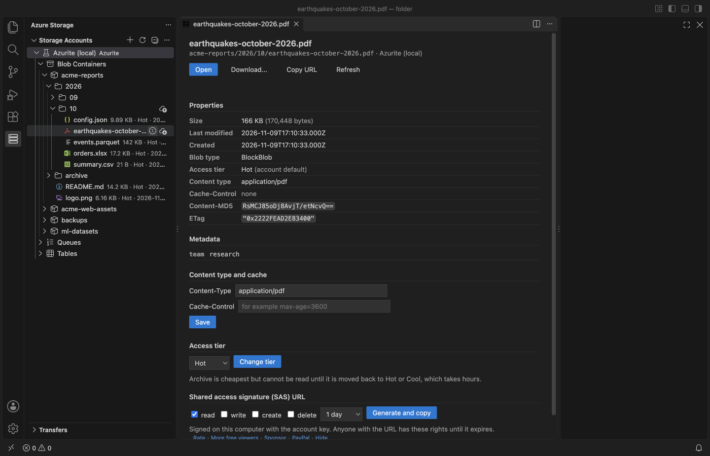

# Azure Storage & Azure Blob Storage Explorer (Blob, Queue, Table, Azurite)

Browse Azure Blob Storage, Queue Storage and Table Storage in VS Code, Cursor, Windsurf and GitHub Codespaces. Connect with a connection string, an account name and key, a SAS URL, Azurite in one click, or Microsoft Entra ID. No Azure sign-in is needed and no desktop app. Free, no telemetry. It connects only to the storage endpoints you add.

Not made by or affiliated with Microsoft. "Azure" is a Microsoft trademark; this is an independent extension by Zovo.

## What it does

- Connect in seconds: Paste a connection string or a SAS URL (account or container), type an account name and key, or click "Connect to Azurite". Entra ID is optional and uses the Microsoft sign-in that VS Code already has. Keys and SAS tokens stay in your OS keychain.
- Browse big containers: Containers, folders by `/` and blobs load 1,000 at a time with a "Load more" row. Each blob shows its size, access tier and last change. ADLS Gen2 accounts (hierarchical namespace) show their real folders, empty ones too.
- Open blobs: Text and JSON open in an editor tab, and Save writes them back (only if nobody changed the blob in the meantime). A 50 MB log asks first, then shows the first 1 MB with one range request. PDF, Excel, CSV, Parquet, images and other files open in the matching viewer.
- Upload and download with a transfer queue: Drag files or folders from your desktop onto a container or folder. Big files go up in 8 MB blocks, streamed from disk, with progress, Cancel and Retry for each file. Downloads stream to disk. Memory stays flat even for a 2 GB file.
- Manage blobs: Copy URL, generate a SAS URL with the permissions and expiry you pick, set Content-Type and Cache-Control, change the access tier (Hot, Cool, Cold, Archive), rename by server-side copy, and delete. Every delete lists the blobs and says whether soft delete can bring them back.
- Queues: Peek up to 32 messages without changing them, send (plain text or Base64 for Azure Functions), dequeue the next message, clear a queue. Base64 messages are shown decoded.
- Tables: Query with an OData filter, see entities in a grid with their types, double-click a cell to edit it, add and delete entities. Results load 500 at a time.
- Read-only switch: Mark a connection read-only (production, for example) and nothing can be changed from it.

## Connections

| How | What you paste or pick |
|---|---|
| Connection string | `DefaultEndpointsProtocol=https;AccountName=...;AccountKey=...;EndpointSuffix=core.windows.net`, a SAS connection string, or `UseDevelopmentStorage=true` |
| SAS URL | An account SAS URL (`https://<account>.blob.core.windows.net/?sv=...&ss=bqt&...&sig=...`) or a container SAS URL. An expired SAS is caught when you paste it. |
| Account name and key | key1 or key2 from the portal (Security + networking, Access keys) |
| Azurite | One click for 127.0.0.1 (ports 10000 to 10002), or another host such as `azurite` in a Dev Container or Docker Compose (start Azurite there with `--disableProductStyleUrl`, or use its IP address). "Start Azurite in a Terminal" runs `npx azurite` for you. |
| Microsoft Entra ID | The account name. VS Code asks you to sign in with Microsoft once. Your role needs data access, for example Storage Blob Data Contributor. SAS URLs from this connection are user delegation SAS (at most 7 days). |

Nothing connects when VS Code starts. A connection is used the first time you expand it.

## Why this one

These are reviews and open issues of Microsoft's Azure Storage extension, the most installed one. This extension is not a replacement for it and does not come from Microsoft; it is a smaller tool for the jobs below.

| Review or issue | Link | Here |
|---|---|---|
| "Doesn't work in Codespaces when trying to open explorer to see the files" (review, March 2026) and upload failures in Codespaces | [Marketplace reviews](https://marketplace.visualstudio.com/items?itemName=ms-azuretools.vscode-azurestorage&ssr=false#review-details), [#1327](https://github.com/microsoft/vscode-azurestorage/issues/1327), [#1268](https://github.com/microsoft/vscode-azurestorage/issues/1268), [#1269](https://github.com/microsoft/vscode-azurestorage/issues/1269) | Everything runs inside the extension host, in plain JavaScript: no desktop Storage Explorer, no AzCopy, no native module. It works in Codespaces, Dev Containers, Remote SSH and WSL. |
| "Cannot find a compatible Storage Explorer" when opening a table (review) | [Marketplace reviews](https://marketplace.visualstudio.com/items?itemName=ms-azuretools.vscode-azurestorage&ssr=false#review-details) | Tables and queues open in a VS Code tab. |
| SAS token and Entra ID access in restricted tenants | [#1528](https://github.com/microsoft/vscode-azurestorage/issues/1528) | Connect with a SAS URL or connection string, with no Azure account sign-in and no subscription list. |
| Azurite blobs and queues not showing; custom Azurite setups | [#1000](https://github.com/microsoft/vscode-azurestorage/issues/1000), [#1385](https://github.com/microsoft/vscode-azurestorage/issues/1385) | Azurite in one click, on any host. |
| "Takes 2+ minutes to list the blobs" (review) | [Marketplace reviews](https://marketplace.visualstudio.com/items?itemName=ms-azuretools.vscode-azurestorage&ssr=false#review-details) | One request per 1,000 blobs, only for the folder you expand. |

Cursor, Windsurf and VSCodium users install it from Open VSX, where Microsoft's extension is not listed.

## Large files and safety

- Uploads: streamed from disk in blocks (8 MB, larger for huge files, at most 50,000 blocks), 4 blocks at a time, 3 files at a time. Downloads stream into a `.part` file that gets its real name only when complete.
- Downloads never write outside the folder you chose: a blob named `../../.ssh/config` is skipped and listed.
- Every delete, overwrite, dequeue and queue clear asks first. Deleting a container asks you to type its name.
- An archived blob is never downloaded by mistake: opening it tells you to change its tier first.
- Requests that get no answer are retried, then shown as an error after 30 seconds (setting).

## Free and Pro

Connecting, browsing, opening, editing, upload, download, the transfer queue, SAS URLs, properties, tiers, rename, delete, queues and tables are free, with no limits.

Zovo Pro adds 2 tools for professional work, each with 3 free tries:

- Folder sync with a dry run: compares a local folder with a container or folder, shows what is new, changed or missing, then copies only the differences (mirror mode deletes extras after you confirm the list).
- Usage and cost report: size, blob count and an estimated monthly cost per folder and access tier, plus the 10 largest blobs.

Zovo Pro is USD 19 once and unlocks Pro in every Zovo VS Code extension: the ["$19 one time" tier on GitHub Sponsors](https://github.com/sponsors/theluckystrike/sponsorships?tier_id=679878), then "Unlock Zovo Pro with GitHub Sponsors"; or PayPal with a license key by email ("Pay for Zovo Pro with PayPal"). There are no popups: Pro is mentioned only when you start a Pro tool.

## Privacy

- Network: only the storage endpoints of the connections you add. With Entra ID, also Microsoft sign-in through VS Code. With "Start Azurite in a Terminal", npm downloads Azurite in that terminal.
- One call to GitHub only when you choose "Unlock Zovo Pro with GitHub Sponsors". A license key is checked on your computer.
- No telemetry, no analytics, no account.

## Settings

| Setting | Default | |
|---|---|---|
| `azureStorage.pageSize` | 1000 | Items per page in the tree |
| `azureStorage.maxTextPreviewMB` | 10 | Larger text asks: first 1 MB or download |
| `azureStorage.confirmOpenOverMB` | 200 | Larger binary blobs ask before download |
| `azureStorage.blockSizeMB` | 8 | Upload block size |
| `azureStorage.concurrency` | 4 | Blocks of one file at once |
| `azureStorage.parallelTransfers` | 3 | Files in the queue at once |
| `azureStorage.requestTimeoutSeconds` | 30 | Wait for an answer |
| `azureStorage.syncExcludes` | `.git/`, `node_modules/`, `.DS_Store`, `Thumbs.db` | Skipped by folder upload and sync |
| `azureStorage.queueMessageEncoding` | text | First choice for new queue messages |
| `azureStorage.pricePerGBMonth` | list prices | Your prices for the usage report |
| `azureStorage.askForRating` | true | One rating question after real use, never after an error |
| `azureStorage.showSupportLinks` | true | Small Rate, More free tools and Sponsor links on the pages |

## How it was tested

- Unit tests for connection strings, SAS URLs, paths, the transfer queue, table types and the Pro gate.
- Integration tests against Azurite: paging, Unicode and space names, streamed upload and download, SAS URLs, tiers, rename, queues and tables.
- A gate in a real VS Code with the packaged extension, on Azurite: real PDF, PNG, CSV, Parquet, XLSX and JSON files, 10,000 blobs in one folder, a 2 GB file up and down, a queue with 1,000 messages, a table with 50,000 entities, a wrong key, an expired SAS URL, Azurite stopped during an upload, and blob names with `..` and `%2F`.
- A check in VS Code's server inside a Linux container (openvscode-server, opened in a browser, the same split as Codespaces): "Azurite on another host", containers, folders, a JSON blob in an editor tab, the queue and table pages.
- The Azure SDK code also ran on Node 20, the runtime of VS Code 1.90.
- No test used a real Azure account.

## Support Zovo

Zovo extensions are free, with no ads and no tracking. They are made by [theluckystrike](https://github.com/theluckystrike) on GitHub. If this one saves you time, you can support the work:

- [Sponsor on GitHub](https://github.com/sponsors/theluckystrike)
- [PayPal](https://www.paypal.com/paypalme/najzzz)
- [Follow theluckystrike on GitHub](https://github.com/theluckystrike)

### Need your format supported?

Open a [format request](https://github.com/theluckystrike/azure-storage-explorer-vscode/issues/new?template=format-request.yml) with a sample file, and I reply there whether it can be done. For USD 299 once, through [this GitHub Sponsors tier](https://github.com/sponsors/theluckystrike/sponsorships?tier_id=679995), I add your file format or a missing feature to this extension, with tests, within 7 days.

## More tools by Zovo

- [XLSX Viewer, Excel Viewer, CSV Viewer & Parquet Viewer (XLS, CSV Preview)](https://marketplace.visualstudio.com/items?itemName=zovo.table-viewer-vscode) opens CSV, TSV, Excel and Parquet files as a sortable, filterable table.
- [PDF Viewer & PDF Reader to Read and View PDF (Dark Mode)](https://marketplace.visualstudio.com/items?itemName=zovo.pdf-viewer-dark) reads PDFs with a real dark mode, search, an outline and thumbnails.
- [SQLite Viewer & SQLite3 DB File Browser, Database Explorer](https://marketplace.visualstudio.com/items?itemName=zovo.sqlite-table-viewer) browses SQLite tables read-only and runs SELECT queries.
- [Hex Viewer & Binary Viewer, Hex Editor (Large Files)](https://marketplace.visualstudio.com/items?itemName=zovo.zovo-hex-viewer) Hex viewer, binary viewer and hex editor for VS Code that opens files of any size (4 GB and more) in under a second. Insert and delete bytes, compare two files byte by byte, go to offset, find hex or text, a data inspector, copy as C array or base64. Free, works offline.
- [Parquet Grid Viewer: Large File Explorer, Schema & Nested Data (Zovo)](https://marketplace.visualstudio.com/items?itemName=zovo.zovo-parquet-viewer) Free, no Python, no sign-in, works offline. Opens Parquet files as a fast grid: only the footer and the rows on screen are read, so large files open at once. Exact DECIMAL and INT64 values, INT96 timestamps, nested LIST, MAP and STRUCT, every codec (Snappy, Gzip, Zstd, Brotli, LZ4). Filter, sort, search, copy as CSV, JSON or Markdown, export to CSV.

See [all Zovo extensions on the Marketplace](https://marketplace.visualstudio.com/publishers/zovo).
